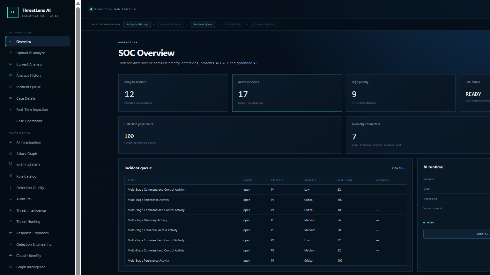

<div align="center">

# ThreatLens AI

### Evidence-first security operations, grounded AI investigation

ThreatLens AI is a production-style SOC investigation platform that turns heterogeneous telemetry into deterministic detections, correlated incidents, governed case evidence, ATT&CK context, attack graphs, threat hunting, threat intelligence, and citation-backed AI analysis.

[](https://github.com/rootmass56/threatlens-ai/actions/workflows/batch7-ci.yml)
[](https://github.com/rootmass56/threatlens-ai/actions/workflows/codeql.yml)
[](https://github.com/rootmass56/threatlens-ai/releases/tag/v1.0.0)
[](pyproject.toml)
[](frontend/)

[Live showcase](https://threatlens-ai-showcase.pages.dev) · [Architecture](docs/FINAL_ARCHITECTURE.md) · [Feature guide](docs/FINAL_FEATURE_GUIDE.md) · [Demo guide](docs/FINAL_DEMO_AND_INTERVIEW_GUIDE.md) · [Security model](docs/FINAL_SECURITY_MODEL.md)

</div>



## At a glance

| | |
| --- | --- |
| Published release | [`v1.0.0`](https://github.com/rootmass56/threatlens-ai/releases/tag/v1.0.0) |
| Current source lineage | `0.14.0` |
| Supported runtime | [`compose.yaml`](compose.yaml) |
| Local console | `http://127.0.0.1:8080` |
| Quality gates | Pytest, Ruff, TypeScript, npm audit, Gitleaks, Trivy, CodeQL |

The core trust rule is simple: **persisted deterministic evidence is authoritative; AI remains downstream of evidence.** The AI layer receives only authorized incident context and governed knowledge, validates citations after generation, and degrades explicitly when grounding or models are unavailable.

## Capabilities

- Multi-source telemetry ingestion, normalization, quarantine, and provenance
- Governed deterministic detections, risk scoring, and alert-to-incident correlation
- MITRE ATT&CK mappings and persisted entity/relationship attack graphs
- Threat-intelligence enrichment with explicit external-intelligence boundaries
- Read-only structured threat hunting across persisted events
- Case notes, evidence registration, SHA-256 integrity, custody history, and analyst handoff
- Durable Redis/PostgreSQL-backed investigation jobs and worker recovery
- Grounded pgvector retrieval, citation validation, and cross-incident isolation
- Adaptive local Qwen Standard/Deep profiles with transparent fallback
- RBAC-protected FastAPI API and React/TypeScript analyst console
- Prometheus/Grafana observability, backup/restore, and controlled recovery runbooks
- CI, dependency auditing, secret scanning, container scanning, CodeQL, and SBOM evidence

## Quick start

### Prerequisites

- Docker Desktop or Docker Engine with Compose v2
- Windows PowerShell 5.1 or PowerShell 7+
- Ollama and the local models listed in the [deployment guide](docs/FINAL_DEPLOYMENT_AND_OPERATIONS.md) when AI readiness is required

### Start the production-style local stack

```powershell
Set-ExecutionPolicy -Scope Process Bypass -Force
.\scripts\bootstrap_batch7_env.ps1
ollama pull qwen3.5:4b
ollama pull qwen3.5:9b
ollama pull qwen3-embedding:0.6b
.\START_THREATLENS.ps1 -RequireAI
.\CHECK_THREATLENS.ps1 -RequireObservability -RequireAI
```

Run these commands from the repository root on Windows. Model downloads are needed only once; the start script can launch Docker Desktop and Ollama when required. The bootstrap command creates the ignored `.env.batch7.local` file with random local secrets. Do not replace it with `.env.example`. To use deterministic SOC features without Ollama, omit `-RequireAI` from the start command and health check.

Open `http://127.0.0.1:8080`. Stop the stack non-destructively with:

```powershell
.\STOP_THREATLENS.ps1
```

Operational details, model setup, backup/restore, migration, and recovery procedures are documented in [Deployment & operations](docs/FINAL_DEPLOYMENT_AND_OPERATIONS.md).

## Architecture

```text
Telemetry → normalization → deterministic detections → alerts → correlation → incidents
                                                        │
                                                        ├─ case evidence / custody / audit
                                                        ├─ MITRE ATT&CK / attack graph
                                                        ├─ threat intelligence / hunting
                                                        └─ authorized incident context
                                                                      │
Governed knowledge → pgvector retrieval ──────────────────────────────┤
                                                                      ▼
                                                        cited AI investigation
```

| Layer | Implementation |
| --- | --- |
| API and authorization | FastAPI, Pydantic, RBAC, request/security middleware |
| Detection and correlation | Python rule engine, governed YAML rules, durable incident state |
| Persistence | PostgreSQL, SQLAlchemy, Alembic, pgvector |
| Async execution | Redis-backed worker with PostgreSQL job state |
| Analyst experience | React, TypeScript, Vite, Nginx |
| AI and retrieval | Ollama, Qwen3.5, Qwen3 Embedding, hybrid retrieval, citation validation |
| Operations | Docker Compose, Prometheus, Grafana, PostgreSQL/Redis exporters |

See the [full architecture](docs/FINAL_ARCHITECTURE.md) and [RAG/AI architecture](docs/FINAL_RAG_AI_ARCHITECTURE.md).

## Reproducible investigation demos

### Enhanced Golden Demo v2

The portfolio scenario follows an Entra identity compromise through Windows authentication, encoded PowerShell, LSASS access, process injection, RDP lateral movement, persistence, payload transfer, C2, DNS tunneling, and evidence destruction.

| 29 normalized events | 26 deterministic alerts | 2 critical incidents | 0 quarantined records |
| :---: | :---: | :---: | :---: |

Its locked evidence includes 19 ATT&CK techniques, 21 resolved entities, 139 scored relationships, and a persisted 76-node / 300-edge attack graph. It also exercises IOC provenance, saved hunts, case tasks, custody verification, analyst feedback, human-approved simulated response, grounded deep analysis, and append-only audit history.

```powershell
.\scripts\demo\start-enhanced-demo-v2.ps1
```

[Walkthrough](demo/README_ENHANCED_DEMO_V2.md) · [Acceptance contract](demo/enhanced-v2-contract.json)

### Frozen v1 acceptance demo

The release-acceptance fixture reproduces a smaller end-to-end investigation with 10 normalized events, 8 deterministic alerts, 5 correlated incidents, and no quarantined records in the valid fixture. Invalid and malformed inputs are exercised separately by quarantine and error-contract tests.

```powershell
.\scripts\demo\start-golden-demo.ps1
```

[Golden Demo contract](demo/README_GOLDEN_DEMO.md) · [Validation evidence](docs/FINAL_TESTING_AND_VALIDATION.md) · [Recruiter walkthrough](docs/FINAL_DEMO_AND_INTERVIEW_GUIDE.md)

## Security and AI boundaries

- Deterministic evidence, external intelligence, analyst inference, and AI interpretation remain distinct.
- Incident context is server-compiled and authorization-scoped.
- Retrieved text is treated as untrusted data; prompt-injection patterns and invalid citations are rejected.
- Cross-incident named requests and unsupported attribution are blocked.
- Authentication, RBAC, secret handling, auditability, input validation, and concurrency controls are tested release contracts.
- AI output assists investigation; it never becomes independent proof of compromise.

See [`SECURITY.md`](SECURITY.md), the [security model](docs/FINAL_SECURITY_MODEL.md), and the [threat model](docs/THREAT_MODEL_BATCH7.md).

## Repository map

| Path | Responsibility |
| --- | --- |
| `api/` | FastAPI boundary, authentication, RBAC, routes, and middleware |
| `core/`, `correlation/`, `attack/` | Deterministic analytics, incident correlation, and ATT&CK context |
| `database/`, `migrations/` | Persistence model and Alembic schema history |
| `jobs/`, `rag/` | Durable AI jobs, governed retrieval, grounding, and model routing |
| `frontend/` | React/TypeScript SOC console |
| `rules/` | Governed detections plus positive, negative, and boundary fixtures |
| `ops/`, `monitoring/` | Security audits, load checks, metrics, and dashboards |
| `deploy/compose/` | Demo overlay and historical migration/regression Compose definitions |
| `scripts/demo/` | Specialized reproducible demo entrypoints |
| `demo/`, `presentation/`, `showcase/` | Acceptance contracts and portfolio assets |
| `docs/` | Current guides, runbooks, and clearly labeled engineering history |
| `release/`, `sbom/` | Release-manifest integrity and dependency evidence |

The root intentionally contains only the supported runtime, primary start/stop/check commands, and standard project configuration. Historical Compose definitions remain under `deploy/compose/legacy/` because migration and regression gates still exercise them.

## Validation

```powershell
python -m pytest -q
python -m ruff check .
python -m scripts.verify_release_manifest

Push-Location frontend
npm ci
npm run typecheck
npm run build
Pop-Location
```

The protected workflow additionally runs dependency auditing, secret scanning, SBOM verification, Trivy container scanning, and CodeQL. Exact acceptance evidence and limitations are documented rather than implied:

- [Testing and validation](docs/FINAL_TESTING_AND_VALIDATION.md)
- [Known limitations](docs/FINAL_LIMITATIONS.md)
- [Troubleshooting](docs/FINAL_TROUBLESHOOTING.md)

## Documentation

| Topic | Document |
| --- | --- |
| Documentation index | [`docs/README.md`](docs/README.md) |
| Architecture | [`FINAL_ARCHITECTURE.md`](docs/FINAL_ARCHITECTURE.md) |
| Feature guide | [`FINAL_FEATURE_GUIDE.md`](docs/FINAL_FEATURE_GUIDE.md) |
| Deployment and operations | [`FINAL_DEPLOYMENT_AND_OPERATIONS.md`](docs/FINAL_DEPLOYMENT_AND_OPERATIONS.md) |
| Security model | [`FINAL_SECURITY_MODEL.md`](docs/FINAL_SECURITY_MODEL.md) |
| RAG / AI architecture | [`FINAL_RAG_AI_ARCHITECTURE.md`](docs/FINAL_RAG_AI_ARCHITECTURE.md) |
| Testing and validation | [`FINAL_TESTING_AND_VALIDATION.md`](docs/FINAL_TESTING_AND_VALIDATION.md) |
| Demo and interview guide | [`FINAL_DEMO_AND_INTERVIEW_GUIDE.md`](docs/FINAL_DEMO_AND_INTERVIEW_GUIDE.md) |
| Runbooks | [`docs/runbooks/`](docs/runbooks/) |
| Presentation assets | [`presentation/README_PRESENTATION.md`](presentation/README_PRESENTATION.md) |

## Release lineage

- **`v1.0.0`** is the immutable accepted release snapshot.
- **`0.14.0`** remains the internal source version for compatibility with the accepted runtime contract.
- Earlier milestone documents and Compose definitions are retained only where they support governed regression, migration, or knowledge contracts.

## Responsible use

ThreatLens AI is an educational and defensive security engineering project. Use it only with systems, telemetry, and environments you are authorized to assess.
